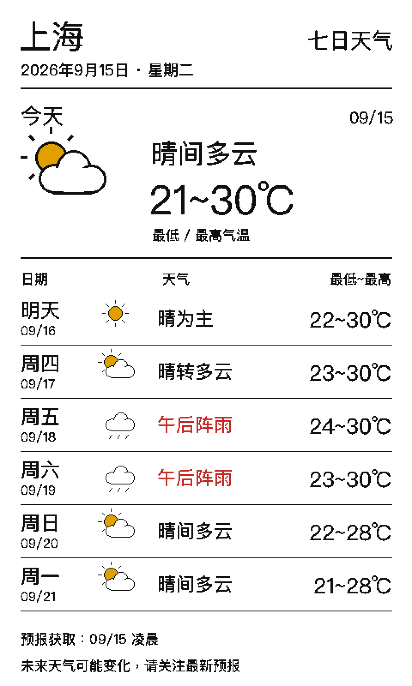

# 箱门鲜知 / RefrigeratorFoodManagement

一个可自行搭建的低功耗冰箱门水墨屏项目。项目使用 ESP32-S3、7.5 英寸四色
电子纸、微信小程序和 FastAPI 后端，把食材、待办、照片、黄历天气、天气预报、
行情与课程表显示在冰箱门或教室墙面上。



## 项目组成

- `backend/`：FastAPI 后端、数据库迁移、画面渲染和第三方服务适配。
- `miniapp/`：微信小程序客户端。
- `firmware/`：ESP32-S3 配网、低功耗轮询、电子纸刷新和签名 OTA 固件。
- `hardware/`：外壳生成脚本、STL、装配检具和结构验证文件。
- `shared/`：OpenAPI 文档和设备通信协议。
- `infra/`：本地及自托管部署示例。
- `kindle/`：可选的 Kindle 显示客户端。
- `docs/`：产品设计、装配、出厂和用户说明。

## 主要功能

- 食材库存与保质期管理
- 家庭成员共享与待办事项
- 水墨屏独立相册轮播
- 黄历、天气及七日天气预报
- 数字货币、美股、A 股和港股行情展示
- 竖屏三日课程表与横屏一周课程表
- BLE 安全配网和设备绑定
- 五分钟低功耗检查与签名 OTA 升级
- 未绑定设备显示专属小程序码

## 硬件基线

当前主要硬件包括：

- ESP32-S3 N16R8 开发板
- Good Display GDEM075F53 7.5 英寸四色电子纸
- DESPI-C02 转接板
- Seeed Lipo Rider Plus
- 3.7 V 锂电池
- 3D 打印前框、中托和后盖

推荐从 [`hardware/enclosure_v0_7`](hardware/enclosure_v0_7/README.md) 开始。
V0.7 是当前推荐打印结构；
[`hardware/enclosure_v0_9_ultrathin`](hardware/enclosure_v0_9_ultrathin/README.md)
是 15 mm 超薄工程样机，完成实物验证前请勿用于送人设备。
CAD 验证环境和复现命令见 [`hardware/README.md`](hardware/README.md)。

## 本地启动

### 1. 后端

需要 Python 3.12、Docker Desktop 和 [uv](https://docs.astral.sh/uv/)。

```bash
cp backend/.env.example backend/.env
docker compose -f infra/docker-compose.yml up -d
cd backend
uv sync --frozen
uv run alembic upgrade head
uv run uvicorn app.main:app --reload
```

示例配置默认使用本地开发登录、模拟识别、模拟天气和模拟行情，不会消耗第三方
服务额度。

### 2. 微信小程序

```bash
cp miniapp/config.example.js miniapp/config.local.js
```

修改 `config.local.js` 中的后端地址，然后用微信开发者工具打开 `miniapp/`。
公开仓库使用 `touristappid`，发布自己的小程序前请替换为你申请的 AppID，并关闭
开发登录。

### 3. ESP32 固件

固件入口位于
[`firmware/bringup/frame_download_display`](firmware/bringup/frame_download_display/README.md)。
先复制示例配置并生成独立设备身份：

```bash
cp firmware/bringup/frame_download_display/device_secrets.h.example \
  firmware/bringup/frame_download_display/device_secrets.h
cp firmware/bringup/frame_download_display/ota_public_key.h.example \
  firmware/bringup/frame_download_display/ota_public_key.h
```

不要把真实设备密钥、配对图、OTA 私钥或签名固件提交到仓库。批量设备出厂流程见
[`docs/FACTORY_PROVISIONING.md`](docs/FACTORY_PROVISIONING.md)。

## 自托管

本地开发使用 [`infra/docker-compose.yml`](infra/docker-compose.yml)。生产部署模板位于
[`infra/production`](infra/production/README.md)。所有示例值都必须替换；不要让公开
客户端默认连接到他人的生产服务器。

天气、行情、照片存储、微信登录和图片识别需要各服务商的独立账号与凭据。项目不
附带任何第三方 API 权限，也不保证行情数据的再分发权。

## 安全提示

- 锂电池不得挤压、刺穿、短路或在结构干涉情况下强行闭合外壳。
- 磁片应避开 ESP32 天线、裸露电路和可能被吸附的金属件。
- 正式打印前先打印对应检具，并实测 USB-C、按键、屏幕和螺丝间隙。
- 本项目是 DIY 原型，不是经过认证的消费电子产品，也不构成食品安全或投资建议。

安全问题请参阅 [`SECURITY.md`](SECURITY.md)，参与方式请参阅
[`CONTRIBUTING.md`](CONTRIBUTING.md)。

## 许可证

本仓库采用分区许可证：

- 软件、固件、协议和部署代码：Apache License 2.0。
- `hardware/` 下的原创硬件设计：CERN-OHL-S-2.0。
- `docs/` 下的原创文档和项目图片：CC BY-SA 4.0。
- 第三方组件和素材保留其原始许可证与服务条款。

完整文本位于 [`LICENSES/`](LICENSES/)，第三方说明位于
[`backend/THIRD_PARTY_NOTICES.md`](backend/THIRD_PARTY_NOTICES.md)。
