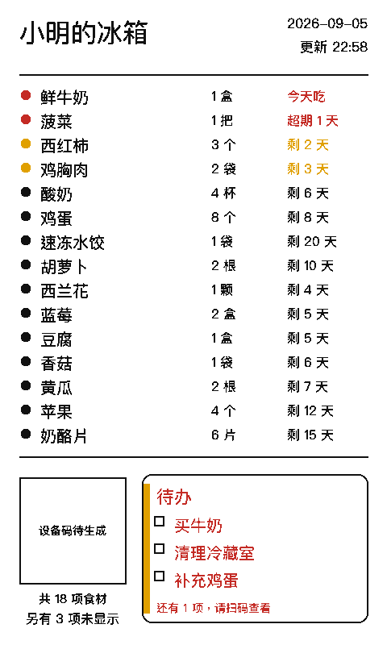
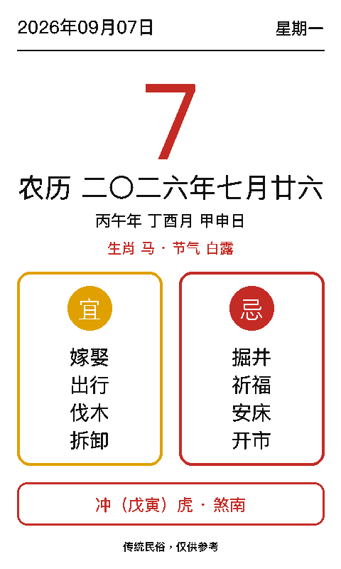
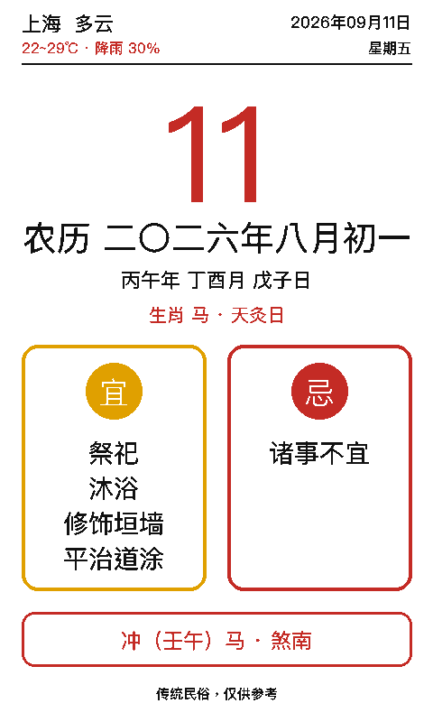
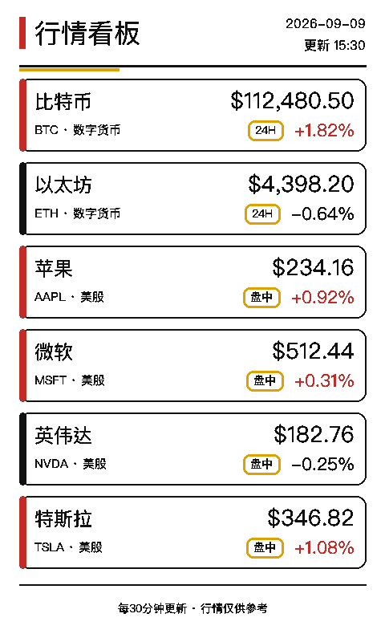
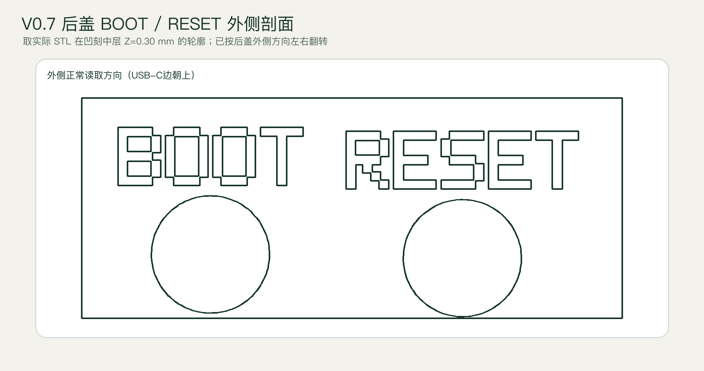

# 冰箱水墨屏用户使用说明书

版本：V1.3（行情看板本地开发版）
适用设备：冰箱水墨屏 V0.7 墨水屏设备
更新日期：2026-09-09

> 本说明书适用于已经完成出厂检测的设备。若设备已经组装完成，请从“首次绑定”
> 开始使用；DIY 装配人员还应阅读“V0.7 装配说明”。

## 1. 产品用途

冰箱水墨屏是一套安装在冰箱门外侧的食材管理设备。用户在微信小程序中维护食材、
保鲜日期、待办事项和墨水屏相册，设备每 5 分钟检查一次新画面，并在有变化时
刷新四色墨水屏。

墨水屏有四种互斥的显示模式：

- **食材清单模式**：显示以下内容：

- 当前家庭的冰箱名称；
- 最多 15 项食材及建议食用状态；
- 最多 3 条待办事项；
- 进入微信小程序的设备小程序码；
- 最近一次画面生成时间。

- **独立相册模式**：只全屏显示一张 3:5 竖版四色照片，不显示食材、待办、
  小程序码或时间。家庭成员可以选择每 1、3、6、12 或 24 小时轮换一次。

- **完整简版黄历模式**：全屏显示公历、星期、农历、年月日干支、生肖、节气或
  节日、前 4 项“宜”、前 4 项“忌”和冲煞，不显示食材、待办、小程序码或照片。
  黄历属于传统民俗信息，仅供参考。

- **行情看板模式**：第一版全屏显示最多 6 项 BTC、ETH 或美股的定时行情快照，
  当前可选 AAPL、MSFT、NVDA 和 TSLA，包括名称、代码、美元价格、涨跌幅、市场
  状态和更新时间。行情仅供
  参考，不构成投资建议。

墨水屏断电后仍会保留最后一幅画面，这是正常现象，不代表设备仍在联网。

## 2. 安全须知

1. 设备只能安装在冰箱外侧或其他干燥的金属表面，不得放入冷藏室、冷冻室或靠近水槽。
2. 使用合格的 5V USB 电源，不得使用破损的充电线。
3. 设备内置聚合物锂电池。发现鼓包、破损、异味或异常发热时，立即停止充电和使用。
4. 不要挤压、刺穿、弯折或自行改接电池；电池接头极性不得接反。
5. 设备背面含强磁铁，应远离磁卡、机械手表和对磁场敏感的物品；植入式医疗设备使用者应遵循医疗设备厂商的距离要求。
6. 不要按压水墨屏中央、折死 FPC 排线，也不要使用金属尖物操作 BOOT、RESET 孔。
7. 儿童使用时应由成人协助，避免拆卸小零件或磁铁。

## 3. 认识设备

- **正面**：7.5 英寸四色墨水屏。
- **顶部中央**：USB-C 充电口。
- **背面指示灯窗口**：查看充电状态和电量指示。
- **BOOT 孔**：配网/清除网络配置。
- **RESET 孔**：重新启动设备。
- **设备标签**：设备编号和小程序码；设备编号用于识别该台设备。

从设备背面看，USB-C 充电口朝上时，BOOT 在左、RESET 在右。

## 4. 首次绑定

### 4.1 准备条件

- 一部已登录微信的手机；
- 已发布的“冰箱水墨屏”微信小程序；
- 可以正常上网的 2.4GHz Wi-Fi；
- Wi-Fi 名称和密码；
- 设备保持通电，手机距离设备不超过 1 米。

### 4.2 操作步骤

1. 给设备接通电源。未保存配置的设备会自动进入蓝牙配网模式。
2. 使用微信扫描设备标签或墨水屏上的小程序码。
3. 未绑定设备会进入“绑定墨水屏”页面；输入家庭使用的 2.4GHz Wi-Fi 名称和密码。
4. 按手机提示允许微信使用蓝牙。Android 手机还可能要求“附近设备”或定位权限。
5. 点击“开始绑定”，保持手机靠近设备，不要切换页面或断开设备电源。
6. 小程序显示“绑定成功”后，等待设备联网并下载第一幅库存画面。
7. 墨水屏完成刷新后，进入小程序“今日”页确认家庭名称和库存一致。

配网过程中，Wi-Fi 密码通过加密连接传给设备，不会写入普通业务日志。

## 5. 小程序日常使用

### 5.1 页面说明

- **今日**：查看临期、今日到期、已过期食材和家庭摘要。
- **食材**：新增、编辑、消耗、丢弃、删除食材，并查看操作历史。
- **待办**：从“我的 → 水墨屏显示 → 食材管理”进入，维护要显示在墨水屏上的
  待办事项。
- **我的**：管理家庭、成员、冰箱名称、墨水屏设备、提醒和隐私数据。
- **我的 → 水墨屏显示**：选择食材管理、完整简版黄历、行情看板或独立相册；
  页面显示对应预览，并提供行情和相册管理入口。

### 5.2 新增食材

1. 进入“食材”，点击“新增食材”。
2. 填写名称、数量、单位、储存位置、入库日期和建议食用日期。
3. 点击“保存并更新库存”。
4. 返回食材列表确认数据存在；设备会在下一次检查到新版本时刷新。

### 5.3 快速记一笔

在快速记一笔中输入自然语言，例如“买了两盒牛奶”“牛奶喝完了”或“冷藏室有哪些
快过期的东西”。写操作必须先检查确认卡片，再点击确认。

### 5.4 导入订单图片

1. 进入“导入订单图片”，选择一张完整订单图或最多 9 张连续截图。
2. 点击“开始识别”，等待系统生成确认卡片。
3. 逐项核对食材名称、数量、单位和日期，修改错误内容。
4. 确认无误后批量入库。

订单图片只用于识别，识别完成后会删除；异常临时文件最长保留 24 小时。

### 5.5 设置水墨屏待办

1. 打开“我的 → 水墨屏显示”，选择“食材管理”。
2. 点击食材预览下方的“管理待办”。
3. 点击“新增一条”，输入待办内容。
4. 可保存最多 10 条，每条最多 40 个字符。
5. 点击“保存待办”。家庭管理员和普通家庭成员都可以编辑。
6. 墨水屏只显示前 3 条，其余内容可在小程序查看。

### 5.6 修改冰箱名称

1. 进入“我的 → 家庭成员”。
2. 在“冰箱名称”中输入新名称，例如“小明的冰箱”。
3. 点击“保存名称”。

只有家庭管理员可以修改名称，最长 40 个字符；过长内容会在墨水屏上省略。

### 5.7 设置墨水屏相册

1. 进入“我的 → 水墨屏显示”，选择“独立相册”，再点击“管理相册”。家庭管理员
   和普通家庭成员都可以操作。
2. 点击“上传照片”，从手机相册选择一张 JPG/PNG；单张不得超过 5MB。
3. 后端会按画面中心裁切成 3:5 竖版，并转换成黑、白、黄、红四色预览。若主体
   不在画面中心，应先在手机相册中裁好后重新上传。
4. 仔细核对预览。满意时点击“确认加入轮播”；不满意时点击“放弃并删除”。未
   确认照片不会显示到墨水屏。
5. 每个家庭最多保存 6 张照片。可以使用“上移/下移”调整确认照片的轮播顺序。
6. 选择每 1、3、6、12 或 24 小时轮换一次；默认每 6 小时轮换。
7. 返回“水墨屏显示”，选择“独立相册”启用。也可以在相册管理中点击某张照片的
   “立即显示”，让它成为下一幅画面。
8. 等待设备下一次联网轮询。需要恢复库存画面时，在“水墨屏显示”中选择
   “食材管理”。

删除操作不可恢复。删除最后一张确认照片后，系统会自动恢复食材清单模式。照片
原图不长期保存，只保存用户看到并确认过的四色显示图。

### 5.8 设置完整简版黄历

1. 进入“我的 → 水墨屏显示”。家庭管理员和普通家庭成员都可以操作。
2. 在四种显示模式中选择“完整简版黄历”。
3. 在页面下方核对当天预览，内容包括农历、干支、生肖、节气/节日、宜忌和冲煞。
4. 如需显示天气，打开“显示当天城市天气”，搜索并选择所在城市。家庭管理员和
   普通成员都可以修改城市或关闭天气。
5. 页面会预览城市、天气、最低/最高温及降雨概率。天气来源说明只显示在小程序
   设置区，水墨屏底部不显示来源文字。
6. 等待设备下一次联网轮询，最迟约 5 分钟显示黄历画面，不需要重新烧录固件。
7. 需要恢复库存或照片时，回到同一页面选择“食材管理”或“独立相册”。

黄历按北京时间每日变化；同一天内设备会收到 304 并保持当前画面，不会反复全刷。
天气默认每 3 小时从服务端更新。临时获取失败时继续显示当天最近一次有效天气；
跨日或缓存过旧时隐藏天气，但黄历仍可正常显示。
不同历书对宜忌可能存在差异，本产品使用固定算法版本提供传统民俗参考，不用于
医疗、法律、投资或其他重要决策。

### 5.9 设置行情看板

1. 进入“我的 → 水墨屏显示”，点击“行情看板”。
2. 点击预览下方的“管理行情”。家庭管理员和普通成员都可以操作。
3. 从目录中选择 BTC、ETH、AAPL、MSFT、NVDA 或 TSLA，点击“添加到墨水屏”。
4. 每个家庭最多选择 6 项；使用“上移/下移”调整水墨屏上的显示顺序。
5. 选择每 15、30 或 60 分钟更新一次，默认每 30 分钟。
6. 夜间暂停默认开启，北京时间 23:00–07:00 不主动获取新行情；如果需要在夜间
   查看美股盘中快照，可以关闭夜间暂停。
7. 点击“设为墨水屏当前显示”，等待设备下一次联网检查。

上涨项目使用红色，其他涨跌使用黑色；黄色状态框表示 24H、盘中、收盘、快照或
数据延迟。行情供应商异常时会保留最近一次成功数据并标记“延迟”。行情存在延迟、
缺失或供应商差异，仅供参考，不构成投资建议或交易依据。

## 6. 画面更新规则

- 设备正常情况下每 5 分钟检查一次新画面。
- 食材、待办、冰箱名称、显示模式或当前照片发生变化时，服务端生成新画面，设备
  下载后刷新。
- 数据没有变化时，设备不会重复刷新，屏幕没有闪烁属于正常现象。
- 刚保存内容后请先等待 5 分钟；网络较慢时可再等待一个周期。
- 屏幕最多显示 15 项食材和 3 条待办，未显示内容仍保存在小程序中。
- 右上角时间是服务端生成当前画面的北京时间，并不是持续运行的电子时钟。
- 相册模式按 6、12 或 24 小时轮换；设备在时间点后的下一次联网检查中取得新照片。
- 黄历模式使用北京时间日期；同一天内容和 ETag 保持稳定，跨日后的下一次联网
  检查取得新黄历画面。
- 行情模式按 15、30 或 60 分钟周期生成快照；周期未到时设备收到 304，不重复
  刷新。夜间暂停开启时，北京时间 23:00–07:00 保持最后一幅行情画面。

## 7. 充电与电源

本设备使用 3.7V 5000mAh 带保护板聚合物锂电池和 Lipo Rider Plus 电源模块。
Lipo Rider Plus 的 USB-C 输入支持 5V 充电，USB-A 端向 ESP32 输出 5V。

### 7.1 充电步骤

1. 将设备平放或稳定吸附在冰箱门上，确认充电线不会拉扯设备。
2. 将 USB-C 公头完全插入设备顶部中央的充电口。
3. 另一端连接合格的 5V USB 电源；建议使用 5V/2A 电源。
4. 从背面观察窗检查充电状态灯和四格电量灯。
5. 充电过程中可保持设备工作；如外壳或电池区域明显发热，立即断电检查。
6. 长时间无人使用时，断开外部电源，并定期检查电池状态。

不得使用鼓包或没有保护板的锂电池。用户不得自行拆开外壳更换电池。

## 8. 重启、重新配网和解绑

### 8.1 日常重启

使用塑料圆头杆短按一次 RESET。该操作只会重启设备，不会删除 Wi-Fi、绑定关系或
屏幕内容。正常重启时不要按住 BOOT。

### 8.2 清除网络并重新配网

仅在更换路由器、修改 Wi-Fi 密码或准备重新绑定时操作：

1. 完全松开 BOOT。
2. 短按一次 RESET。
3. 设备启动后会提供约 8 秒的清配置窗口。
4. 在窗口内单独按住 BOOT 约 2 秒，然后松开。
5. 设备清除本地网络配置并进入蓝牙配网模式。
6. 回到“我的 → 墨水屏设备”，按首次绑定流程重新操作。

> **重要：不要按住 BOOT 再按 RESET。** 这样会进入固件下载模式，设备不会正常联网。

### 8.3 误入下载模式

如果串口显示 `DOWNLOAD(USB/UART0)` 或 `waiting for download`：

1. 完全松开 BOOT。
2. 只短按一次 RESET。
3. 如果仍未恢复，断开电源，确认 BOOT 没有卡住，等待 5 秒后重新通电。

### 8.4 解绑或转让设备

1. 管理员进入“我的 → 墨水屏设备”，点击“解绑”。
2. 按“清除网络并重新配网”步骤清除设备本地配置。
3. 确认设备重新进入蓝牙配网模式。
4. 转让设备前应清除屏幕上原家庭的库存画面；无法自行处理时联系设备提供者刷新中性欢迎画面。

只在小程序解绑而不清除设备配置，不等于完成转让前的数据清理。

## 9. 安装到冰箱门

1. 使用干净软布擦净冰箱门外侧，去除水分、油污和灰尘。
2. 双手托住设备两侧，将背面平行靠近目标位置。
3. 确认设备完整贴合后再松手，不要让某一个角先猛烈吸附。
4. 轻推检查是否会向下滑动；有滑动时不得继续使用，应检查磁条、后盖和表面状态。
5. 尽量避开冰箱门铰链、门缝、显示面板及高温散热区域。
6. USB-C 充电线应自然下垂，不得成为拉动设备的受力点。

设备总重约 285g。正式使用前必须在目标冰箱门上完成不少于 24 小时的防滑观察。

## 10. V0.7 DIY 装配说明

已购买整机的用户无需执行本章。DIY 装配前，应先完成所有检具测试；任何部件需要
拉开、弯曲或靠螺丝强行闭合时，应停止装配。

V0.7 外形为 120×184×19mm，由前框、中托和后盖组成。

### 10.1 器件位置

设备背面打开、USB-C 充电口朝上时：ESP32 位于左上，Lipo Rider 位于顶部中央，
DESPI-C02 位于右侧中部，806090 电池横放在下方。

### 10.2 装配顺序

1. **验证打印件**：前框、中托、后盖空壳必须能徒手自然组合、徒手分离。
2. **安装磁条**：将 9 颗 38×9×1.5mm 磁条先干装，再用极薄环氧胶固定；朝冰箱门的一面保持同一极性。
3. **安装水墨屏**：显示面朝前框窗口，FPC 从右侧开放位置自然伸出；不得按压显示区。
4. **固定 ESP32**：使用 4 颗 M2×4mm 自攻螺丝，天线朝顶部，BOOT、RESET 朝下并与后盖孔对应。
5. **固定 Lipo Rider**：使用 4 颗 M2×4mm 自攻螺丝，USB-C 输入口朝设备顶部，USB-A 输出口朝下。
6. **固定 DESPI-C02**：使用不超过 0.2mm 的薄双面胶或薄型可拆魔术贴；FPC 不受拉、不折死。
7. **固定电池**：使用不超过 0.2mm 的薄双面胶固定底面，可在四周加窄 EVA 条防止横向移动。
8. **完成接线**：确认电池红线为正、黑线为负；ESP32 与 DESPI-C02 按固件接线表连接。
9. **通电测试**：先不盖后盖，依次验证电源、Wi-Fi、服务端画面下载和四色刷新。
10. **闭合外壳**：三层自然落位后，使用 4 颗 M2×14mm 自攻螺丝对角、分次拧紧。

不得使用 M2×16mm 螺丝夹紧外壳，也不得用螺丝把没有自然落位的部件强行拉合。

## 11. 常见问题

### 11.1 搜索不到设备

- 确认设备已清除旧配置并进入蓝牙配网模式。
- 打开手机蓝牙和微信的蓝牙/附近设备权限。
- 手机靠近设备至 1 米以内，关闭小程序后重新进入设备页。

### 11.2 Wi-Fi 连接失败

- 设备只支持 2.4GHz Wi-Fi。
- 重新检查 Wi-Fi 名称和密码，注意空格和大小写。
- 将设备移到路由器附近重新配网。
- 双频合一的路由器必须允许 2.4GHz 设备接入。

### 11.3 保存成功但屏幕没有更新

- 等待至少一个 5 分钟检查周期。
- 确认修改的是设备当前绑定的家庭。
- 确认设备电量充足、Wi-Fi 正常。
- 短按 RESET 重启；不要同时按 BOOT。
- 连续 10 分钟仍未更新时，联系设备提供者并提供更新时间和设备编号，不要提供 Wi-Fi 密码。

### 11.4 屏幕断电后仍显示内容

这是电子墨水屏的正常特性。画面保留不能证明设备在线；请以小程序设备状态和最新
更新时间为准。

### 11.5 设备从冰箱门向下滑

立即取下设备，清洁接触表面，检查 9 颗磁条是否全部安装、后盖是否变形。未解决前
不要再次悬挂，避免跌落损坏屏幕。

### 11.6 充电灯不亮或无法开机

- 更换已确认正常的 5V 电源和 USB-C 线。
- 确认插头已经完全插入顶部开口。
- 仍无反应时停止拆机，联系设备提供者检查电池、接头极性和 Lipo Rider。

### 11.7 上传照片后屏幕仍显示库存

- 上传后必须先点击“确认加入轮播”，再回到“水墨屏显示”选择“独立相册”。
- 等待至少一个 5 分钟设备检查周期，或点击目标照片的“立即显示”后再等待检查。
- 确认修改的是设备当前绑定的家庭，设备电量和 Wi-Fi 均正常。
- 仍未更新时先关闭相册模式，确认库存画面能否正常更新，再联系设备提供者。

### 11.8 四色照片效果不理想

四色墨水屏不能还原连续色彩。高对比、主体居中、背景简洁的照片效果最好。如果
预览中人物或主体被裁掉，请不要确认；先在手机相册中按 3:5 竖版裁切，再重新上传。

## 12. 清洁、存放和运输

- 使用干燥柔软的布擦拭，不得用水冲洗或使用腐蚀性清洁剂。
- 搬动设备时双手托住，禁止只提充电线或 FPC。
- 长期存放应置于阴凉、干燥、远离金属碎屑和易燃物的位置。
- 运输前关闭供电并妥善防护屏幕；电池运输应遵守承运方对锂电池的规定。

## 13. 主要规格

| 项目 | 规格 |
|---|---|
| 产品外形 | 120×184×19mm（V0.7） |
| 显示屏 | GDEM075F53，7.5 英寸，800×480，黑白黄红四色 |
| 主控 | 微雪 ESP32-S3-DEV-KIT-N16R8 |
| 网络 | 2.4GHz Wi-Fi、蓝牙配网 |
| 更新周期 | 正常情况下每 5 分钟检查一次 |
| 电池 | 806090，3.7V 5000mAh，带保护板 |
| 电源模块 | Seeed Lipo Rider Plus 106990290 |
| 充电输入 | USB-C，5V；建议 5V/2A 电源 |
| 屏幕容量 | 食材模式最多 15 项食材、3 条待办；黄历模式显示宜/忌各 4 项 |
| 小程序待办容量 | 最多 10 条，每条最多 40 个字符 |
| 墨水屏相册 | 每个家庭最多 6 张，JPG/PNG，单张不超过 5MB |
| 相册轮播周期 | 6、12 或 24 小时；默认 6 小时 |
| 固定方式 | 9 颗 38×9×1.5mm 钕铁硼硬磁条 |

## 14. 获取帮助

联系设备提供者时，请准备：

- 设备编号；
- 小程序提示的完整错误文字；
- 墨水屏右上角更新时间；
- 问题发生时间；
- 设备是否正在充电、指示灯状态；
- 必要时提供串口日志，但不要发送 Wi-Fi 密码、设备密钥或微信 AppSecret。

## 15. 参考资料

- Seeed Studio：Lipo Rider Plus 官方资料，`https://wiki.seeedstudio.com/cn/Lipo-Rider-Plus/`。
- V0.7 详细装配基线：`hardware/enclosure_v0_7/ASSEMBLY_GUIDE.md`。
- 设备出厂流程：`docs/FACTORY_PROVISIONING.md`。
