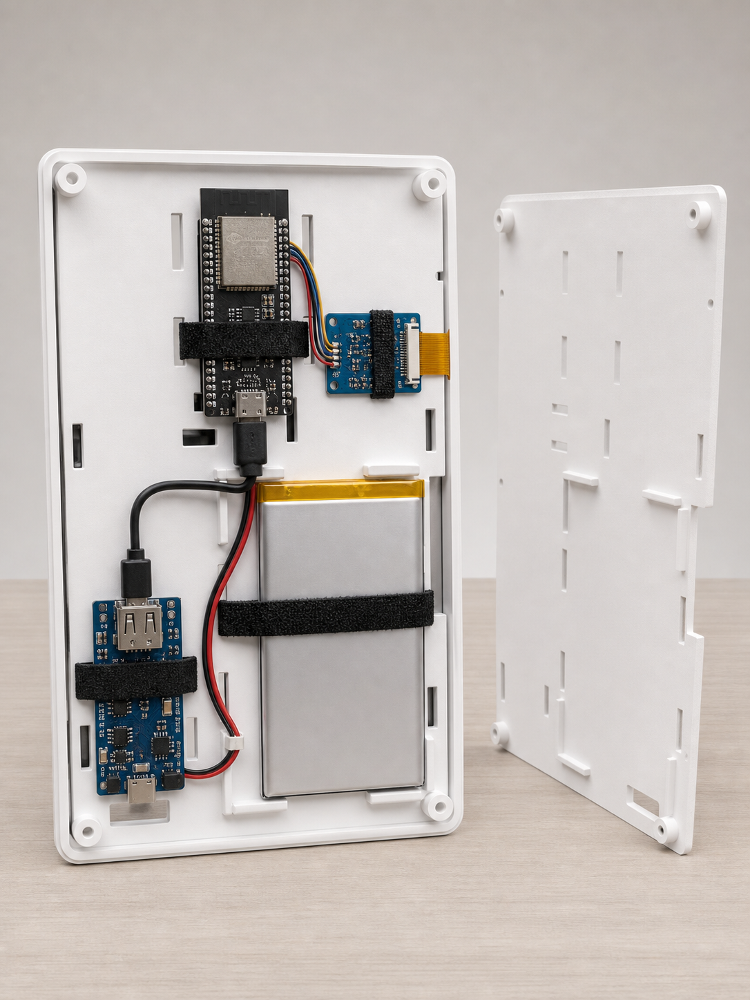
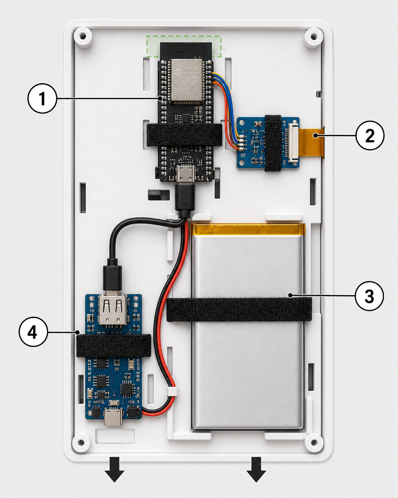

# 外壳 V0.1 元件安装说明

> **V0.1 中层托板和后盖已经停用（2026-08-15）**：下方内容只保留为旧方案问题
> 记录，不再用于装配。V0.1 只继续使用正面边框；请改用
> [`../enclosure_v0_3/ASSEMBLY_GUIDE.md`](../enclosure_v0_3/ASSEMBLY_GUIDE.md)
> 中的 V0.3 托板、后盖和安装步骤。

本说明适用于已经打印完成的 `front_bezel_v0_1`、`middle_carrier_v0_1` 和
`rear_cover_v0_1`。所有图片用于说明摆放关系和走线方向；板载接口、丝印和排线
触点方向必须以实际硬件为准。

## 1. 开盖后的预期效果

## 2. 元件位置

安装时从设备背面观察，外壳顶部朝上，后盖底部的充电口和开关孔朝下。

| 编号 | 元件 | 位置和方向 |
|---|---|---|
| 1 | ESP32-S3 | 顶部中央竖放；天线端朝上，USB-C 朝下 |
| 2 | DESPI-C02 与屏幕 FPC | 右上方横放；FPC 插座朝右侧排线让位口 |
| 3 | 806090 电池 | 中下部偏右竖放；导线自然朝左下引出 |
| 4 | Lipo Rider Plus | 左下方竖放；USB-C 充电口和开关朝底部开孔 |

绿色虚线区域是 ESP32-S3 天线净空区。该区域不得放电池、磁铁、金属件、扎带
扣或成束导线。

## 3. 安装前断电检查

1. 拔掉外部 USB 充电器。
2. Lipo Rider Plus 开关拨到 `OFF`。
3. 电池暂时不要接入 Lipo Rider Plus。
4. DESPI-C02 在断电状态下确认 `RESE=2.2Ω`。
5. 用手摸一遍中层托板，清除毛刺和可能刺伤电池的尖角。
6. 确认 M2 热熔螺母已经安装并完全冷却，烙铁远离屏幕和电池。

## 4. 依次固定四个元件

### 4.1 ESP32-S3

1. 把开发板放在顶部中央的 `27 × 65 mm` 安装区域。
2. 模组天线端朝外壳顶部，USB-C 接口朝下。
3. 用两条细魔术贴扎带穿过上、下两组长孔固定。
4. 扎带只能压在没有按键、接口和高元件的位置，不能压住 `BOOT`、`RST`、
   USB-C 或天线。
5. 轻轻晃动外壳，开发板不应移动，但扎带不得让 PCB 弯曲。

### 4.2 DESPI-C02

1. 将板放在 ESP32-S3 的右下方，保持横向。
2. 白色 FPC 插座对准托板右侧排线让位口。
3. 用一条细魔术贴扎带固定，避开 FPC 锁扣、排针和 `RESE` 开关。
4. 插入屏幕 FPC 后再压紧锁扣；排线应平直进入，不得折出死角。

### 4.3 806090 电池

1. 将电池平放在右下方四组定位块之间。
2. 保护板和导线出口不得顶住定位块、螺丝柱或后盖。
3. 使用两条较宽的软魔术贴带固定，只需防止滑动，不得压瘪电芯。
4. 不要用细尼龙扎带直接勒电池，不要在电池表面拧螺丝或粘难以移除的硬胶。

### 4.4 Lipo Rider Plus

1. 将板放在左下区域。
2. USB-C 充电口和拨动开关朝外壳底部，对准后盖的两个开口。
3. USB-A 5V 输出口朝上。
4. 用一条魔术贴扎带固定，不能遮住 USB-A、USB-C、开关和指示灯。
5. 暂时合上后盖但不拧螺丝，确认充电线能够插入、开关能够拨动。

## 5. 连接和走线

所有插拔和接线必须断电进行。

### 5.1 屏幕与 DESPI-C02

- 屏幕橙色 FPC 从托板右侧让位口进入 DESPI-C02。
- 沿排线原有弯曲方向布置，不反折、不扭转。
- 插入到位后锁紧 FPC 锁扣，再轻拉确认不会松脱。

### 5.2 DESPI-C02 与 ESP32-S3

| DESPI-C02 | ESP32-S3 |
|---|---|
| `BUSY` | `GPIO9` |
| `RES` | `GPIO7` |
| `D/C` | `GPIO8` |
| `CS` | `GPIO10` |
| `SCK` | `GPIO12` |
| `SDI` | `GPIO11` |
| `GND` | `GND` |
| `3.3V` | `3V3` |

线束沿 ESP32-S3 右侧进入 DESPI-C02，使用托板中间的通用扎带孔固定。不得把
DESPI-C02 接到 `5V` 或 `VIN`。

### 5.3 电池与 Lipo Rider Plus

- 接入前用万用表确认：电池红线是正极，黑线是负极；插座极性必须与板端一致。
- 如果插头外形能插入但极性相反，必须先改正端子顺序，不能试插通电。
- 红黑线沿电池左侧向下走到 Lipo Rider Plus，不跨过后盖螺丝柱。

### 5.4 Lipo Rider Plus 与 ESP32-S3

- 使用尽量短的 USB-A 转 USB-C 线。
- USB-A 接 Lipo Rider Plus 的 5V 输出，USB-C 接 ESP32-S3。
- 线缆沿左侧或中间扎带点固定，保留少量拆装余量，不要形成大线圈。

## 6. 闭盖前通电测试

1. 后盖保持打开，检查没有裸露线头、反插插头或被压住的排线。
2. 接入电池，把 Lipo Rider Plus 开关拨到 `ON`。
3. 确认 5V 输出指示正常、ESP32-S3 启动，并能联网下载画面。
4. 执行一次水墨屏刷新，确认画面正常且所有板件没有异常发热。
5. 接入外部 USB-C 充电器，确认能够充电，同时 ESP32-S3 仍能正常工作。
6. 测试完成后关闭开关，再整理线缆。

## 7. 安装后盖

1. 先不装螺丝，把后盖平放到中层托板上。
2. 四边应自然贴合；如果后盖翘起，立即取下检查电池、插头和线束，不得强压。
3. 确认底部充电口、开关孔和外壳位置一致。
4. 装入四颗 M2 后盖螺丝，按对角顺序用手轻轻拧紧。
5. 再次拨动开关和插拔充电线，确认接口没有被外壳卡住。

发现电池鼓包、破损、异味或异常发热时，立即断电并停止使用。
