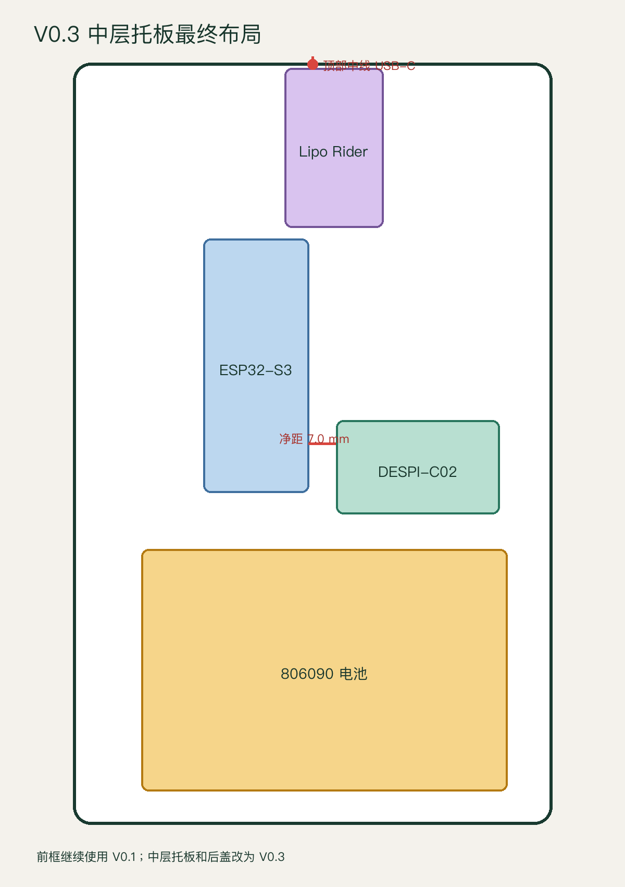

# 外壳 V0.3 安装说明

本说明只适用于以下组合：

- V0.1 正面边框；
- V0.3 中层托板；
- V0.3 后盖。

不要把 V0.2 托板或 V0.1 后盖混入该组合。

## 1. 背面布局

从设备背面观察，外壳顶部朝上：

1. Lipo Rider Plus 位于顶部中央，USB-C 充电口朝上。
2. ESP32-S3 位于左侧中部，天线朝上、板载 Type-C 朝下。
3. DESPI-C02 位于右侧中部，白色 FPC 插座朝右。
4. 806090 电池横放在下部。

## 2. 安装前

1. 外部充电器断开。
2. Lipo Rider Plus 开关拨到 `OFF`。
3. 电池暂时不要插入 Lipo Rider。
4. 用手检查所有打印件，去除会碰到电池或排线的毛刺。
5. 热熔铜螺母必须在电子元件远离后安装，等打印件完全冷却再装屏幕。

## 3. 安装屏幕与中层托板

1. 在 V0.1 前框屏幕定位边内贴 0.5 mm EVA 泡棉胶，不覆盖显示区和 FPC。
2. 自然放入屏幕，不弯折玻璃、不用螺钉直接压玻璃。
3. 将屏幕 FPC 从中层托板右侧让位口穿出。
4. 对准 V0.3 托板的 6 个前框孔，用 M2 × 6 mm 螺钉按对角顺序轻力锁紧。

## 4. 安装 DESPI-C02 与 ESP32

1. 先把屏幕 FPC 平直插入 DESPI-C02 白色 ZIF 插座，再锁紧卡扣。
2. 将 DESPI 放入右侧定位轨，用一条 6～8 mm 魔术贴固定；不得压住 FPC 锁扣、排针和 `RESE` 开关。
3. 将 ESP32 放入左侧区域，用两条细魔术贴固定；不得压住 `BOOT`、`RESET`、Type-C 和天线。
4. 使用尽量短的 SPI 线连接两板，线束经过中间扎带孔，不跨过 ESP32 天线。

接线保持现有固件定义：

| DESPI-C02 | ESP32-S3 |
|---|---|
| `BUSY` | `GPIO9` |
| `RES` | `GPIO7` |
| `D/C` | `GPIO8` |
| `CS` | `GPIO10` |
| `SCK` | `GPIO12` |
| `SDI` | `GPIO11` |
| `GND` | `GND` |
| `3.3V` | `3V3` |

## 5. 安装 Lipo Rider 与电池

1. Lipo Rider 的 USB-C 朝外壳顶部，USB-A 输出朝下。
2. 用 4 颗 M2 × 4 mm 自攻螺钉固定，逐颗轻拧；PCB 不得被强行拉弯。
3. 电池和托板之间垫 0.5 mm EVA，用两条 10～12 mm 软魔术贴固定。
4. 电池仅需防止滑动，不得压瘪或勒紧。
5. 用万用表确认电池红线为正、黑线为负，且插座极性与 Lipo Rider 一致后，才允许插入。
6. 用短 USB-A 转 Type-C 线连接 Lipo Rider 5V 输出和 ESP32 Type-C。

## 6. 开盖通电验收

1. 后盖保持打开，Lipo Rider 开关拨到 `ON`。
2. ESP32 能正常启动、联网并拉取服务端画面。
3. 水墨屏完成一次刷新，电路板和电池无异常发热。
4. 从顶部插入 USB-C 充电器，充电状态正常，ESP32 不重启。
5. 轻晃设备，无元件移动或金属碰撞声。

## 7. 合后盖

1. 整理线束，任何线都不能经过后盖螺柱顶面或压在电池上。
2. 不装螺钉试合后盖；四边必须自然贴合。
3. 顶部 USB-C 线应能完全插入和拔出，插头外壳不顶住开孔。
4. 四颗后盖 M2 螺钉按对角顺序轻力锁紧。
5. 如果后盖翘起，立即拆开检查，禁止用螺钉强压合盖。

发现电池鼓包、破损、异味或异常发热时，立即断电并停止使用。
