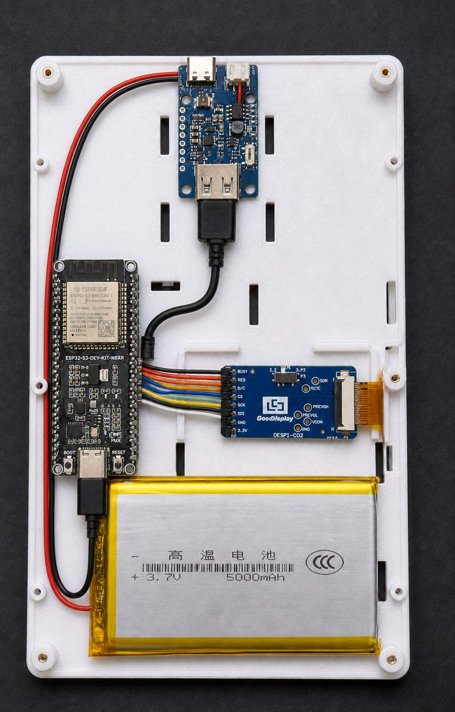
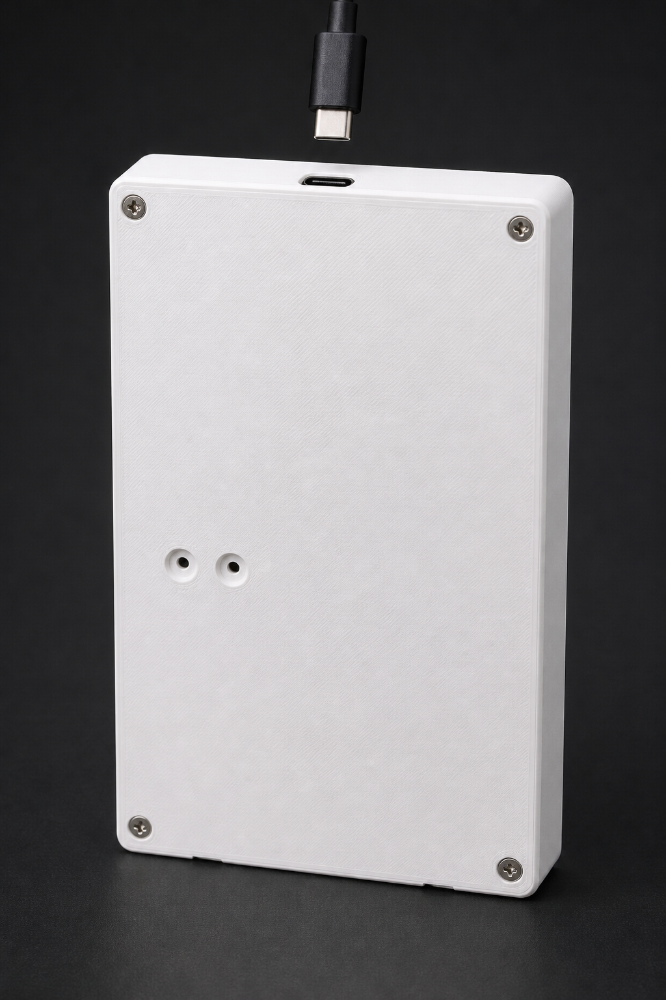

# 外壳 V0.4 安装补充说明

主体安装顺序沿用 V0.3，但必须使用 V0.4 中层托板和 V0.4 后盖。

## 安装效果参考

打开后盖后的元件安装效果：

装上后盖后的背面效果：

> 效果图用于说明外观、相对位置和走线方向。孔位、间距和打印尺寸必须以 STL、
> `manifest.json` 与 1:1 SVG 模板为准；不得从效果图量尺寸。

## ESP32 安装

1. 天线端朝外壳顶部，Type-C 接口朝下。
2. ESP32 放在托板左侧两组扎带孔之间，左右居中后固定。
3. 扎带不得压住天线、BOOT、RESET、Type-C 或高元件。
4. ESP32 与 DESPI 之间使用短 SPI 线，在线束中间扎带孔留少量拆装余量。

## BOOT、RESET 孔验收

1. 合盖前，在 BOOT、RESET 按键表面贴一小点可移除纸胶带作位置标记。
2. 不接电池，轻合后盖，不装螺钉。
3. 从后盖外侧插入 2～3 mm 圆头塑料杆：左孔应正对 BOOT，右孔应正对 RESET。
4. 塑料杆应垂直、轻力触发按键，不得斜压 PCB。
5. 孔位不正时停止装配，不要扩大孔或硬压；先修改模型。

## 合盖前安全检查

- 顶部 USB-C 充电线可以完全插入。
- 屏幕 FPC 平直进入 DESPI，没有折死或受拉。
- 电池没有碰到后盖、螺柱、毛刺或按键导向孔。
- 两个按键孔内没有残留支撑、毛刺或松动塑料丝。
- 使用按压杆时不会碰到 ESP32 上的其他元件。

其余电池、Lipo Rider、DESPI 和后盖安装要求见上一版说明，锂电池安全要求不变。
