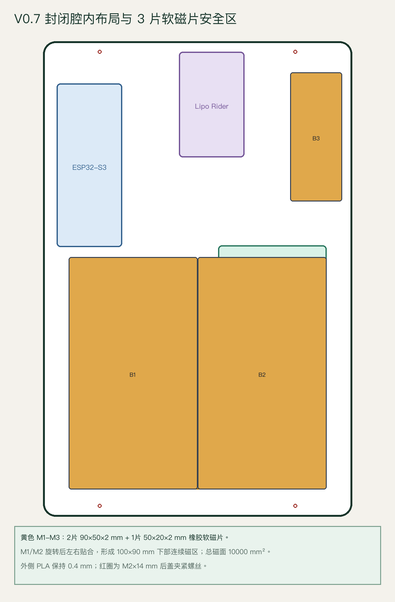
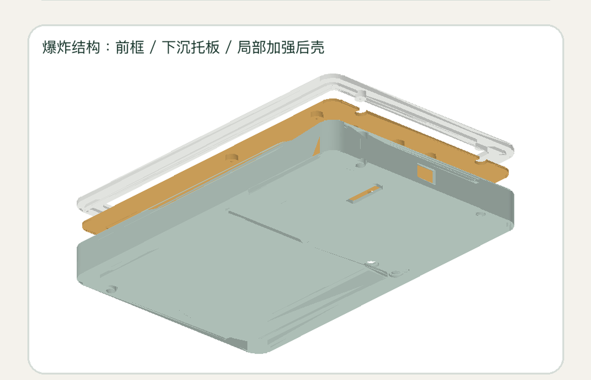
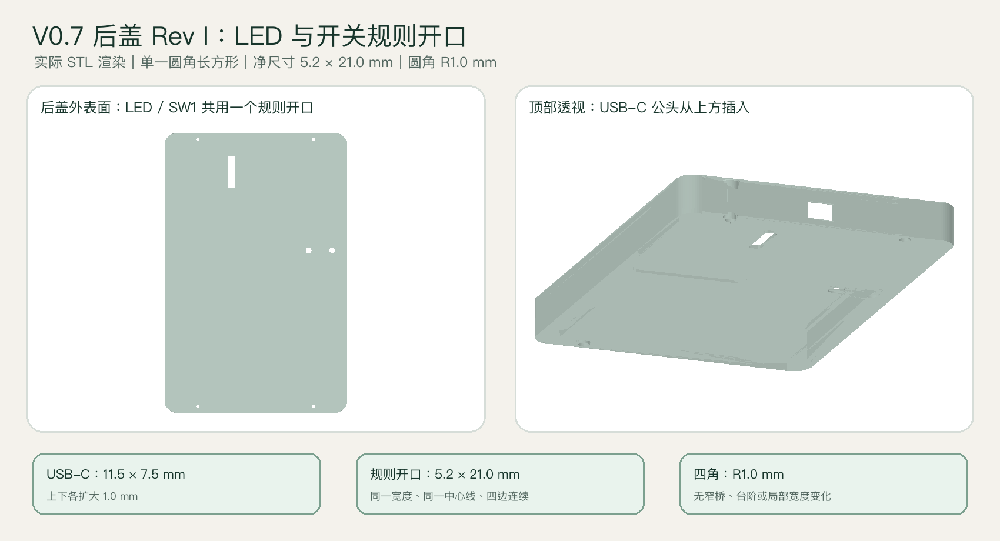
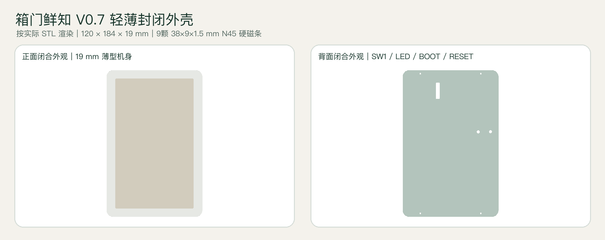

# 冰箱水墨屏外壳 V0.7 安装指导

本说明只适用于 `hardware/enclosure_v0_7` 当前正式版本。安装前请确认使用：

- `front_bezel_v0_7.stl`：前框；
- `electronics_carrier_v0_7.stl`：中层器件托板；
- `rear_cover_v0_7_rev_i_regular_lipo_led_switch_opening.stl`：最新 Rev I 后盖；保留
  Rev E 装配避让和 Rev F 左侧全高薄壁，并将 LED 窗与 Lipo Rider 开关操作区
  合并为一个 `5.2×21.0 mm、R1.0 mm` 的规则圆角长方形开口。

禁止混用 V0.5、V0.6、V0.8 或旧检具。V0.7 整机外形为 `120×184×19 mm`。

> 本说明更新安装顺序和验收方法，不改变任何 STL 尺寸。效果图用于辨认方向和
> 相对位置，孔位与尺寸以 STL、`manifest.json` 和实物为准。

## 1. 先统一观察方向

除“正面显示检查”外，本文默认采用下面的安装视角：

1. 水墨屏显示面朝下，放在柔软、干净、无颗粒的垫布上。
2. 人从设备打开的背面向下看。
3. Lipo Rider 的外部 USB-C 充电口所在方向为“顶部”，当前后盖开口为 `11.5×7.5 mm`。
4. 从该背面视角看：ESP32 在左上，Lipo Rider 在上方中央，DESPI-C02 在右侧
   中部，806090 电池横放在下方。
5. 水墨屏 FPC 在设备正面看位于左侧；设备翻到背面安装时会镜像到右侧，这是
   正常现象。

## 2. 所需物料和工具

### 2.1 电子件

- GDEM075F53 7.5 英寸四色水墨屏；
- DESPI-C02 转接板，`RESE` 开关保持在 `2.2Ω`；
- 微雪 ESP32-S3-DEV-KIT-N16R8；
- Seeed Lipo Rider Plus 106990290；
- 806090 3.7 V 5000 mAh 带保护板聚合物锂电池；
- 一条尽量短的 USB-A 转 USB-C 供电线；
- 8 根短 2.54 mm 连接线，或已经按同一引脚定义制作的防松线束。

### 2.2 紧固和固定材料

- `4` 颗 `M2×4 mm` 自攻螺丝：固定 ESP32；
- `4` 颗 `M2×4 mm` 自攻螺丝：固定 Lipo Rider；
- `4` 颗 `M2×14 mm` 自攻螺丝：最终夹紧前框、中托和后盖；
- 后盖螺丝头外径不超过 `4.6 mm`，头高不超过 `1.5 mm`；
- 2 片 `90×50×2 mm` 和 1 片 `50×20×2 mm` 橡胶软磁片；
- 磁片自带压敏背胶，或薄型丙烯酸转移胶：固定软磁片；
- 厚度不超过 `0.2 mm` 的薄双面胶：固定电池底面；
- 可选 `0.5 mm EVA` 窄条：仅用于电池四周侧向缓冲，禁止垫在电池底下；
- DESPI-C02 可使用薄双面胶或 6～8 mm 宽可拆魔术贴固定，厚度应尽量小。

### 2.3 工具

- 适配 M2 螺丝的小号十字螺丝刀；
- 游标卡尺和万用表；
- 2～3 mm 圆头塑料杆，用于测试 `BOOT`、`RESET`；
- 塑料镊子、记号笔、绝缘胶带和无尘软布。

禁止用金属尖物按压水墨屏、FPC 或锂电池。

## 3. 安装前的六项硬门槛

以下任一项不通过，都不要开始正式装机：

1. 三个正式件没有翘曲、开裂、明显象脚和尖锐毛刺。
2. 前框、中托、后盖不装电子件时可以徒手自然组合；不得拉开后盖或靠螺丝强行
   拉合。
3. 整片 `50×20×2 mm` 小软磁片能徒手放入 `fit_test_soft_magnet_2mm_skin_0p4_v0_7.stl`，胶层余量合适，`0.4 mm` PLA 外皮无针孔或开裂。
4. USB-C 公头能完全插入 `fit_test_usb_c_opening_11p5x7p5_v0_7.stl`；随后用 Rev I 开口检具确认 Lipo Rider 的 5 个指示灯可见，
   `5.2×21.0 mm、R1.0 mm` 规则开口完整成形，并能完整切换 SW1 的 ON/OFF。
5. 电池没有鼓包、破损、异味或异常发热，实测厚度不超过 `10 mm`。
6. 裸机状态下 ESP32、DESPI-C02、水墨屏和电源模块已经分别测试正常。

正式打印前应使用的检具和判定标准见 [README.md](README.md) 的“必须先打印和验证”。
当前后盖必须先打印 `fit_test_rear_corner_clearance_v0_7_rev_e.stl`，与现有前框角部
检具空壳试合；确认四角与螺丝柱均能徒手落位、徒手分离后，才打印完整后盖。

## 4. 第一步：处理后盖软磁片

软磁片必须先安装并让胶完全固化，之后才能把后盖靠近电子件。

1. 后盖外表面朝下、空腔朝上放平。
2. 确认磁性面朝向冰箱门，背胶面朝向后盖内侧槽底。
3. 两片 `90×50×2 mm` 均旋转 90°，先放左片、再放右片；两片在 X=0 接缝处直接贴合，中间没有隔墙。
4. 将 `50×20×2 mm` 小磁片竖放到右上槽位。先完成三个槽位的无胶干装，确认均能自然落到底且不突出槽口。
5. 若磁片自带背胶，清洁槽底后撕膜贴合；无背胶时只使用薄型丙烯酸转移胶，禁止使用厚泡棉胶。
6. 从中心向四周压平，排出空气。不得敲击、强压，也不得在磁片后面增加钢片。
7. 清除挤出的胶，确认胶没有流入后盖螺丝孔、按键孔、USB-C 开口或 LED 窗。
8. 后盖保持平放，按胶水说明完全固化。固化前不要把后盖吸到铁板上。

通过标准：3 片软磁片均低于或齐平于槽口，两片大磁片的中缝贴合且不拱起；轻晃后盖没有松动声，外表面没有开裂、
鼓包或胶水渗出。

## 5. 第二步：把水墨屏装入前框

1. 在桌面铺无尘软布，将前框外观面朝下、内侧定位凸起朝上。
2. 确认前框右侧中段是开放的，左、上、下三侧有定位凸起。
3. 水墨屏显示面朝向前框窗口，FPC 朝右侧开放口。
4. 双手托住水墨屏的硬质边缘，从右侧沿平面缓慢滑入；不要按压显示区。
5. 让屏幕左、上、下边自然进入定位凸起内，右侧屏幕边不得顶住圆角收口。
6. 从正面翻看一次：显示区应完整、居中，无黑边被异常遮挡，无玻璃受力变形。
7. 再放回“显示面朝下”的安装姿态，FPC 自然从右侧伸出，不折死、不受拉。

第一版试装不要在玻璃背面大面积贴胶。若存在轻微间隙，只能在不覆盖显示区、
不接触 FPC 的硬质非显示边放极薄缓冲条。

通过标准：水墨屏能徒手滑入和取出；完全落位后不翘起；FPC 不被夹住；前框不需
掰开。

## 6. 第三步：在中托上安装四块电子件

先在独立的中托上安装，不要一开始就把中托压到屏幕背面。

### 6.1 安装 ESP32

1. 中托器件安装面朝上，顶部朝向 Lipo Rider/外部充电口。
2. ESP32 放在左上四个螺丝柱上：天线端朝顶部，板载 USB-C、`BOOT` 和
   `RESET` 朝下。
3. 四个板孔与四个托板孔全部自然对齐后，放入 4 颗 `M2×4 mm` 自攻螺丝。
4. 按左上、右下、右上、左下的对角顺序逐步拧紧。
5. 螺丝头刚接触 PCB 即停止；PCB 不得弯曲，天线区域不得贴金属或覆盖线束。

禁止用 `M2×6 mm` 代替这里的 `M2×4 mm`。

### 6.2 安装 Lipo Rider Plus

1. Lipo Rider 放在上方中央四个螺丝柱上。
2. 板载 USB-C 输入口朝设备顶部，USB-A 5 V 输出口朝设备下方。
3. 四孔自然对齐后，用 4 颗 `M2×4 mm` 自攻螺丝按对角顺序轻拧固定。
4. 检查开关可操作、USB-C 口没有被托板遮挡、LED 没有被固定材料盖住。

### 6.3 预放 DESPI-C02

1. DESPI-C02 放入右侧中部的定位导轨。
2. 白色 FPC 插座朝右，正对中托右侧 FPC 让位口。
3. 排针朝左，便于与 ESP32 之间使用短线连接。
4. 此时先不要永久粘死，保留少量位置调整空间，等屏幕 FPC 插好后再固定。
5. `RESE` 开关在断电状态下确认处于 `2.2Ω`。

### 6.4 安装电池

1. 电池横放在中托下半部的 `94×62 mm` 下沉区域内。
2. 保护板和线头不得顶住螺丝柱、导轨或硬边。
3. 电池底部只贴不超过 `0.2 mm` 的薄双面胶；不得使用 0.5 mm EVA 垫底。
4. 如需防止横向晃动，可在四周贴 0.5 mm EVA 窄条，但不能叠到电池底面。
5. 轻压固定时只压电池硬质边缘，禁止按压或弯折软包中心。
6. 电池插头暂时不要接入 Lipo Rider。

## 7. 第四步：完成断电接线

所有接线、拆线、FPC 插拔和 `RESE` 档位调整都必须在下面三个条件同时满足时
进行：外部充电器已拔掉、Lipo Rider 开关在 `OFF`、电池未连接。

### 7.1 ESP32 与 DESPI-C02

| DESPI-C02 | ESP32-S3 N16R8 |
|---|---|
| `BUSY` | `GPIO9` |
| `RES` | `GPIO7` |
| `D/C` | `GPIO8` |
| `CS` | `GPIO10` |
| `SCK` | `GPIO12` |
| `SDI` | `GPIO11` |
| `GND` | `GND` |
| `3.3V` | `3V3` |

逐根连接并再次核对标签。DESPI-C02 的 `3.3V` 只能接 ESP32 的 `3V3`，禁止接
`5V`、`VIN` 或 `VBUS`。线束经过中托内部走线孔，不能跨过 ESP32 天线、压住
按键或进入四个外壳螺丝孔。

### 7.2 Lipo Rider 与 ESP32

1. 将短 USB-A 转 USB-C 线的 USB-A 端插入 Lipo Rider 的 5 V 输出口。
2. USB-C 端插入 ESP32 的板载 USB-C 口。
3. 线缆贴中托表面走线，保留可拔插余量，不得在后盖合上后顶住电池。

### 7.3 核对电池极性

1. 万用表拨到直流电压档。
2. 红表笔接电池插头红线端，黑表笔接黑线端。
3. 正常应显示正的电池电压，通常约 `3.0～4.2 V`；若显示负数，说明插头极性
   与线色或接口定义不一致，禁止插入 Lipo Rider。
4. 只有测量为正且 Lipo Rider 电池座正负定义一致后，才可连接电池。

## 8. 第五步：连接屏幕 FPC 并落下中托

1. 保持前框和屏幕显示面朝下，中托器件面朝上放在其旁边。
2. 将中托靠近前框右侧，让屏幕 FPC 从中托右侧让位口自然穿出。
3. 轻轻打开 DESPI-C02 白色 ZIF 插座锁扣。
4. 按之前裸机点屏已经验证过的接触面方向，将 FPC 平直插到底；不得反插或斜插。
5. 保持 FPC 不动，均匀扣紧 ZIF 锁扣。轻拉确认 FPC 不会自行退出。
6. 将 DESPI-C02 调整回定位导轨内，用薄双面胶或窄魔术贴固定；不得覆盖 ZIF
   锁扣、排针、`RESE` 开关或测试焊盘。
7. 缓慢把中托落到前框上，四个大让位孔应自然套过前框螺丝柱。
8. 检查整个过程没有牵拉 FPC，没有线束位于中托与前框接触面之间。

通过标准：中托靠自重和轻微手扶即可落位，四孔同轴，四边齐平；不需要弯曲中托、
拉开前框或用螺丝强拉。

## 9. 第六步：开盖通电测试

后盖先不要安装。

1. 再次确认所有 SPI 线和 FPC 正确。
2. 连接电池，将 Lipo Rider 开关拨到 `ON`。
3. ESP32 应正常启动并连接 Wi-Fi，水墨屏应能拉取并刷新一次有效画面。
4. 检查 DESPI-C02、ESP32、Lipo Rider 和电池，无异味、异响和异常发热。
5. 从后盖顶部方向插入外部 USB-C 充电器，确认 Lipo Rider 充电指示正常，ESP32
   不反复重启。
6. 断开外部充电器，再把 Lipo Rider 开关拨到 `OFF`，然后进行合盖。

任何器件异常发热、屏幕花屏、ESP32 重启或电池电压异常，都应立即断电排查，
禁止带故障合盖。

## 10. 第七步：试合后盖

后盖方向参考：顶部中央是 USB-C 充电开口，外侧能正常阅读 `BOOT`、`RESET`；
两个字样分别位于对应按键孔的正上方。

1. 先整理所有线束：不得压在电池上，不得越过后盖四个螺丝柱，不得进入软磁片座，
   不得遮住 Lipo Rider LED。
2. 后盖空腔朝下，USB-C 开口对准 Lipo Rider USB-C 输入口；Rev I 的
   `5.2×21.0 mm` 规则开口同时对准 5 个 LED 和 SW1 开关。
3. 不装螺丝，垂直落下后盖。
4. 四边必须徒手自然完全落位；Rev E 的四角入口与 `Ø6.6 mm` 螺丝柱让位不得
   出现卡滞；Rev F 左侧下部 `1.8 mm` 原墙及顶部 `1.8 mm` 高、`0.8 mm` 厚恢复带均不得顶住屏幕边缘，右侧完整折边保持原结构。
5. 从顶部试插 USB-C 公头，插头应完全进入，不顶住后盖。
6. 从 LED 窗应能看见充电灯和四段电量灯。
7. 用指甲或小号非金属拨杆从 Rev I 规则开口下部操作 SW1，确认开关能完整到达 ON/OFF
   两端且不被槽边卡住；不要使用金属螺丝刀伸入开口。
8. 用 2～3 mm 圆头塑料杆从后盖外侧轻按：`BOOT` 孔只触发 BOOT，`RESET`
   孔只触发 RESET，塑料杆保持垂直且不碰其他元件。

如果任一边翘起、USB-C 插头不能完全插入、按键孔偏位或内部有夹线，立即提起后盖
重新整理。禁止通过拧螺丝消除间隙。

## 11. 第八步：最终锁紧

1. 保持三层已经自然完全落位。
2. 从后盖外侧放入 4 颗 `M2×14 mm` 自攻螺丝。
3. 先让每颗螺丝吃入 1～2 圈，不要一次拧到底。
4. 按左上、右下、右上、左下的对角顺序分两到三轮逐步锁紧。
5. 螺丝头与后盖沉孔稳定接触后停止；不得压弯后盖或压缩锂电池。
6. 沿四周检查接缝均匀，整机厚度约 `19 mm`，摇动时没有零件移动声。

禁止使用 `M2×16 mm` 夹紧 V0.7。

## 12. 第九步：最终功能验收

依次完成，每项都记录“成功/失败”：

1. Lipo Rider 开关拨到 `ON`，ESP32 正常启动。
2. ESP32 能连接 2.4 GHz Wi-Fi，并访问正式服务器。
3. 水墨屏能够刷新，画面方向、文字和更新时间正确。
4. 顶部 USB-C 可以完全插拔，充电状态正常。
5. 后盖 LED 窗能看到充电灯和电量灯。
6. 不拆后盖即可通过 Rev I 规则开口下部完整拨动 Lipo Rider 开关，槽边不干涉行程。
7. `BOOT`、`RESET` 两孔分别能够正确触发对应按键。
8. 连续工作 30 分钟，外壳、电池和电路板无异常发热或异味。
9. Lipo Rider 关闭后，设备断电；再次打开能正常恢复。

## 13. 第十步：冰箱门吸附验收

当前软磁片结构的 CAD 与程序尺寸检查已通过，但实际保持力必须由本批次磁片、打印件
和冰箱门共同验证，不能只根据模型判定安全。

1. 清洁冰箱门和后盖接触面，去除油污、水和灰尘。
2. 第一次测试放在冰箱门较低位置，下方不要放易碎物，并用手托住设备。
3. 轻放吸附，确认后盖大面积贴平，不能只有某一个角接触。
4. 连续观察 10 分钟，设备不得向下滑动。
5. 再做 24 小时静置测试，设备位置不得变化，软磁片不得松动。
6. 开关冰箱门 20 次，设备不得移动、旋转或脱落。
7. 测试期间确认 Wi-Fi 信号和画面同步正常。

在 10 分钟、24 小时和开关门测试全部通过前，不要把设备安装在高处长期使用。
若出现缓慢下滑，优先检查后盖是否贴平、PLA 表面摩擦、软磁片实际吸力、磁性面方向、胶层
厚度和冰箱门材质；不要只靠增加螺丝预紧力处理。

## 14. 出现问题时的停止条件

遇到以下任一情况立即断电并拆开检查：

- 电池鼓包、破损、异味或明显发热；
- 连接电池后电压为负，或 Lipo Rider 输出异常；
- FPC 被折死、锁扣松动或屏幕玻璃受压；
- 中托/后盖必须弯曲、拉开或靠螺丝才能装入；
- USB-C 插头不能完全插入；
- 后盖压住电池、线束或电子元件；
- 软磁片松动、外壳开裂，或设备在冰箱门上缓慢下滑。
