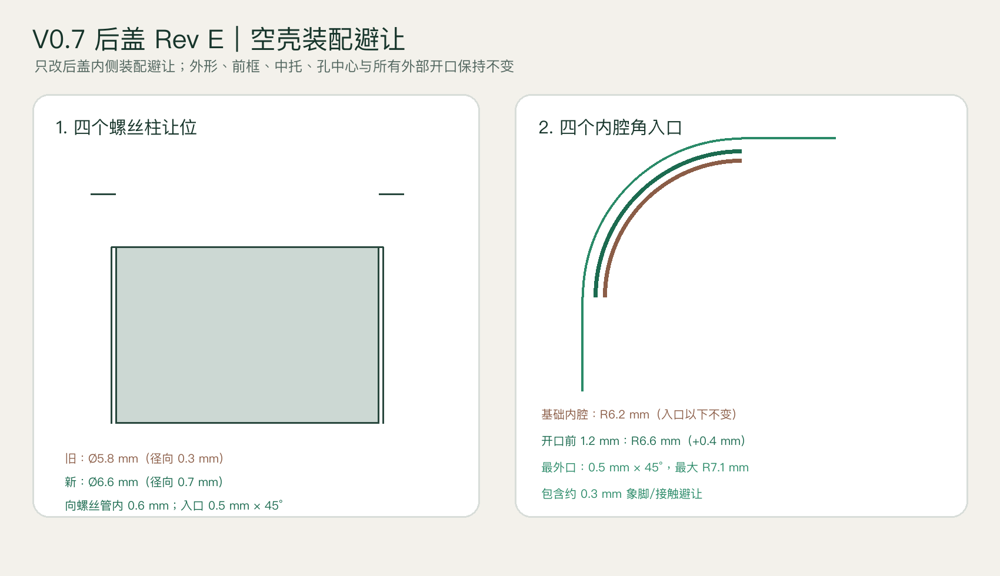
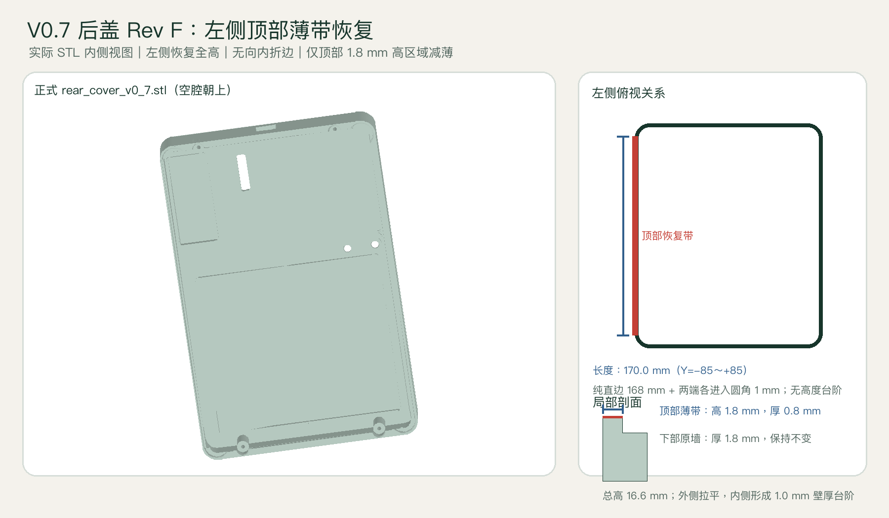

# 冰箱水墨屏外壳 V0.7：19 mm 轻薄封闭版

V0.7 在 V0.6 基础上独立设计，不覆盖或删除 V0.6。外轮廓保持
`120×184 mm`，整机目标厚度缩小到 `19.0 mm`。

完整的实物装机顺序、接线表、安全要求和逐项验收标准见
[`ASSEMBLY_GUIDE.md`](ASSEMBLY_GUIDE.md)。安装时以该说明为主，本文件继续记录
结构尺寸、打印参数和检具要求。

## 最终结构边界

| 项目 | V0.6 | V0.7 |
|---|---:|---:|
| 外形 | 120×184 mm | 120×184 mm |
| 整机厚度 | 21.4 mm | 19.0 mm |
| 后盖实体深度 | 19.0 mm | 16.6 mm |
| 后盖基础皮层 | 4.0 mm | 1.4 mm，软磁片位置局部结构高 2.6 mm |
| 器件托板 | 1.6 mm | 1.4 mm，电池区再下沉 0.5 mm |
| 后盖夹紧螺丝 | M2×16 mm | M2×14 mm |

现有屏幕、ESP32-S3、DESPI-C02、Lipo Rider Plus 和 806090 电池的位置不变。
ESP32 继续使用四颗 `M2×4 mm` 自攻螺丝固定。

## 后盖 Rev E 空壳装配避让

实物空壳试装确认：即使完全取出中托和电子件，旧后盖仍会在四个角及前框四个
螺丝柱位置顶住。Rev E 因此只修改 V0.7 后盖的内侧入口；前框、中托、外轮廓、
螺丝中心、USB-C、LED、BOOT 和 RESET 均不移动；软磁片槽按当前确认布局更新。

- 前框螺丝柱保持 `Ø5.2 mm`；后盖内侧让位由 `Ø5.8 mm` 扩大至 `Ø6.6 mm`，
  单边径向间隙由 `0.3 mm` 增加到 `0.7 mm`。
- `Ø6.6 mm` 让位向后盖螺丝管内部延伸 `0.6 mm`；更深位置仍保留原螺丝管，
  不改变 M2×14 mm 的中心和有效结构。
- 螺丝柱让位入口增加 `0.5 mm × 45°` 导角。
- 后盖基础内腔在入口以下仍保持 `116.4×180.4 mm、R6.2 mm`。
- 只在后盖开口向内的前 `1.2 mm` 深度，将四角局部放宽 `0.4 mm` 到 `R6.6 mm`；
  最外口再增加 `0.5 mm × 45°` 导角，其中包含约 `0.3 mm` 的象脚/接触避让。
- 外形仍为 `120×184×19 mm`，外观没有变化。

Rev E 的四角避让继续保留在当前模型中。完整后盖打印前必须先打印
`fit_test_rear_corner_clearance_v0_7_rev_e.stl`；最新完整后盖文件见下面的 Rev F
说明，避免继续使用旧文件名造成切片缓存。



## 后盖 Rev F 左侧拉平薄壁

Rev F 保留 Rev E 的四角和螺丝柱装配避让，只修改从设备背面观察时的左侧直边。

- 取消左侧前缘原有的 `1.8 mm` 下凹，整段恢复为 `16.6 mm` 全高直线。
- 左侧仍不设置向内折边，避免顶住水墨屏边缘。
- `Y=-85～+85 mm` 的 `170 mm` 区域中，仅恢复出来的顶部 `1.8 mm` 高薄带采用
  `0.8 mm` 壁厚，适配 `0.4 mm` 喷嘴的两道壁线；下部原墙仍为 `1.8 mm` 厚。
- 后盖外轮廓、四角圆弧、右侧折边、螺丝结构、USB-C、LED、BOOT 和 RESET
  均保持不变；软磁片槽按当前确认布局更新。
- 最新正式打印文件为 `rear_cover_v0_7_soft_magnets_2x90x50_1x50x20.stl`；Rev I 的 LED 窗和 Lipo Rider 开关操作区继续保持 `5.2×21.0 mm、R1.0 mm` 的规则圆角长方形开口。



## 前框 Rev F 局部修改

本节记录前框 Rev F 修改。V0.8 保持不动；V0.7 的外轮廓、显示窗口、四个前框
螺丝柱和中托均保持不变，只调整前框定位凸起的两个局部轮廓。

- 上、下、左三条定位凸起统一为 `2.9 mm` 宽。
- 定位凸起外缘距前框上、下、左、右外边均为 `3.6 mm`。
- 四个外角继续保持 `R4.4 mm` 圆弧；左上、左下两个内角由 `R1.5 mm` 改成
  数学意义上的 `90°` 直角，外角及外观圆角不变。
- 后盖内腔为 `R6.2 mm`，与四角前框凸起外圆弧之间保留 `1.8 mm` 径向装配间隙。
- 取消此前人为设置的 `170.0 mm` 右侧净距限制。
- 上方凸起的内侧下边缘保持原高度并水平延伸到右侧外圆弧；下方凸起的内侧上边缘
  同样保持原高度并水平延伸到右侧外圆弧。
- 当前几何自然形成约 `171.0 mm` 的右侧开口，不单独把这个数值作为设计约束。
- 右上和右下外圆弧继续保留；收口处不再出现椭圆、短舌或高度台阶。
- 右侧中段完全开放，屏幕从右侧平移装入。
- 左侧凸起覆盖物理屏幕约 `2.1 mm`；按左侧 `9 mm` 非显示边测量值，仍保留约 `6.9 mm` 非显示区域。
- 不得掰弯或强压水墨屏玻璃。

## 软磁片物料与位置

磁吸改版只修改 V0.7 后盖，中托、器件位置和按键孔均不移动。后盖磁吸结构采用
3 片橡胶软磁片；USB-C 开口保持水平居中，Rev I 将 Lipo Rider 指示灯观察区和开关操作区
合并为一个规则圆角长方形开口。

- 正式装机数量：`3` 片。
- 规格：`2` 片 `90×50×2 mm`，`1` 片 `50×20×2 mm`。
- 材料：磁粉与软质橡胶构成的柔性永久磁片。
- 两片大磁片均旋转 90°，在下部左右直接贴合，组成 `100×90 mm` 连续磁区。
- 大磁片合并槽：`100.6×90.6×2.2 mm`；外围每边预留 `0.3 mm`，中间不设置隔墙。
- 小磁片槽：`20.6×50.6×2.2 mm`，位于右上安全区。
- 外侧正式材料改为 PLA，磁片外侧保持 `0.4 mm`，不得继续减薄。
- 3 片磁片总正面面积 `10000 mm²`；磁片均保持完整，不需要剪孔或缺口。

组合磁区已经避开四颗后盖螺丝柱、BOOT/RESET 沉孔、ESP32 Wi-Fi 天线以及
Lipo Rider LED/SW1 一体开口。下部合并槽距离螺丝管约 `2.1 mm`，距离
BOOT/RESET 沉孔至少约 `1.5 mm`，不得在切片软件中缩放或移动模型。

若磁片自带压敏背胶，使用原背胶固定；无背胶时使用薄型丙烯酸转移胶。不要使用
厚泡棉胶，不要锤击、强压，也不要增加钢背板。

## 电池安装限制

V0.7 的电池区域在托板上表面下沉 `0.5 mm`，局部托板剩余 `0.9 mm`。

- 电池底部只能使用不超过 `0.2 mm` 的薄双面胶。
- 原 V0.6 的 `0.5 mm EVA` 不得贴在电池正下方。
- 0.5 mm EVA 可以剪成窄条，贴在电池四周作为侧向缓冲，但不能叠到电池底面。
- 电池包络按 `94×62×10 mm` 计算；若实测厚度超过 10 mm，停止打印正式件。
- 不得通过拧紧后盖螺丝压缩锂电池。

## USB-C、指示灯与开关开口

- 顶部 USB-C 开口：`11.5×7.5 mm`；宽度保持不变，相比上一版高度在上、下方向各扩大 `1.0 mm`。
- USB-C 开口水平位置不变，中心高度由上一版 `Z=10.0 mm` 下移 `3.0 mm` 至 `Z=7.0 mm`。
- 开口尺寸大于 USB-C 公头金属壳，并为 PLA 打印误差和插入角度预留余量。
- Rev I 的 LED/SW1 共用开口为一个规则的 `5.2×21.0 mm` 圆角长方形，四角统一为 `R1.0 mm`。
- 开口中心取原 LED 观察窗与 SW1 操作槽联合包络的中心，可同时覆盖 Seeed 官方 Eagle
  板文件中的 D2、D3、D4、D5、D7 以及 `SW1 (28.575, 25.186 mm)`。
- 共用开口与最近的软磁片座保持至少约 `16.2 mm` 距离，不改变板卡位置。
- SW1 封装为 `6.7×2.7×3.2 mm`；板卡旋转安装后开关长轴沿设备上下方向。
  槽宽只比开关本体多 `1.1 mm`，槽长只多 `0.3 mm`，仅供指甲或小号非金属拨杆完成
  ON/OFF 全行程，不暴露周边电路。
- Rev I 不再保留窄桥、台阶、上下宽度差或局部横向错位，整个开口为同一宽度、
  同一中心线、四边连续的规则轮廓。
- 共用开口不改变螺丝柱和 Lipo Rider 位置；软磁片槽与开口独立避让。

## 后盖左侧 Rev F 结构

左侧改为全高阶梯壁并去除折边，右侧保持完整高度和向内折边。后盖外轮廓、螺丝结构、按键孔、LED
观察窗和元件位置均不移动；软磁片槽按当前确认布局更新。

- 后盖外轮廓仍为 `120×184 mm`，四角仍为 `R8 mm`。
- 左侧纯直线段为 `184-2×8=168 mm`。
- 薄壁区域设为 `Y=-85～+85 mm`，总长 `170 mm`；即纯直线段加上下各 `1 mm` 圆角过渡区。
- 在这段范围内，左侧向内承托中托的折边完全去除。
- 左侧前缘不再降低，保持 `16.6 mm` 全高。
- 原有下部墙体仍为 `1.8 mm` 厚；只在 `Z=14.8～16.6 mm` 的顶部恢复带采用
  `0.8 mm` 壁厚。外表面连续齐平，内表面在 `Z=14.8 mm` 处形成 `1.0 mm` 壁厚台阶。
- 右侧恢复为完整 `16.6 mm` 高度和原有向内折边。
- 不改变后盖底面厚度，也不改变左上、左下外轮廓圆弧。

## BOOT / RESET 后盖标识

- 从后盖底部/外侧正视、USB-C开口朝上时，文字正常读取为 `BOOT` 和 `RESET`，不再镜像。
- 两个字样分别位于对应按键孔的正上方，与孔中心横向居中；孔位、孔径和沉孔结构均未改变。
- 字形在模型坐标中预先左右镜像，后盖翻面后恢复为正常文字方向。
- 标称笔画宽度由约 `0.42 mm` 增加到约 `0.58 mm`，适配 `0.4 mm` 喷嘴。
- 凹刻深度由 `0.42 mm` 增加到 `0.60 mm`，按 `0.20 mm` 层高为三层；凹刻后仍保留至少 `0.8 mm` PLA 底层。
- 正式打印前先打印 `fit_test_boot_reset_labels_v0_7.stl`：外侧朝上检查文字方向，确认字母连续、无糊边，再打印完整后盖。

## 文件说明

- `front_bezel_v0_7.stl`：V0.7 正面框。
- `electronics_carrier_v0_7.stl`：带 0.5 mm 电池下沉区的器件托板。
- `rear_cover_v0_7_soft_magnets_2x90x50_1x50x20.stl`：最新正式后盖；包含已确认的 3 片软磁片槽、Rev E 装配避让、Rev F 左侧薄壁，以及 Rev I 的 `5.2×21.0 mm、R1.0 mm` LED/SW1 规则开口，切片时优先使用。
- `rear_cover_v0_7_rev_i_regular_lipo_led_switch_opening.stl`：与最新正式后盖内容相同的历史兼容文件名，不建议继续用于切片，避免旧缓存。
- `rear_cover_v0_7_rev_h_combined_lipo_led_switch_opening.stl`、`rear_cover_v0_7_rev_g_lipo_switch_access.stl`、`rear_cover_v0_7_rev_f_flat_left_wall_0p8mm.stl`：与最新 Rev I 后盖内容相同的历史兼容文件名，不建议继续用于切片，避免旧缓存。
- `rear_cover_v0_7.stl`：与最新正式后盖内容相同的通用兼容文件名。
- `rear_cover_v0_7_rev_e_dfm_clearance.stl`：与最新正式后盖内容相同的历史兼容文件名，不建议继续用于切片，避免旧缓存。
- `fit_test_soft_magnet_2mm_skin_0p4_v0_7.stl`：可放入整片 `50×20×2 mm` 小软磁片的低成本检具，用于验证槽尺寸、胶层余量和 `0.4 mm` PLA 外皮，必须先打印。
- `rear_cover_v0_7_magnet_bars_9x38x9x1p5.stl`、`fit_test_magnet_bar_38x9x1p5_v0_7.stl`、`rear_cover_v0_7_magnet_bars_9x40x10x2.stl`、`fit_test_magnet_bar_40x10x2_v0_7.stl`：旧磁铁规格文件，已经作废，不要继续打印。
- `fit_test_lipo_regular_led_switch_opening_v0_7_rev_i.stl`：最新低成本后盖开口检具，用于实测 USB-C 公头插入、五个指示灯可见性、规则开口边界及 SW1 完整 ON/OFF 行程。
- `fit_test_usb_c_opening_11p5x7p5_v0_7.stl`：仅保留顶部局部壁面和 `11.5×7.5 mm` USB-C 开口的简易检具；正式打印完整后盖前，优先用它确认公头可以完全插入且不顶住上下边缘。
- `fit_test_lipo_combined_led_switch_opening_v0_7_rev_h.stl`、`fit_test_lipo_usb_led_switch_openings_v0_7_rev_g.stl`、`fit_test_lipo_usb_led_openings_v0_7.stl`：与最新 Rev I 开口检具内容相同的兼容文件名。
- `fit_test_rear_left_flat_wall_0p8mm_v0_7_rev_f.stl`：最新低成本左侧边框检具，确认全高拉平、无折边、下部 `1.8 mm` 原壁厚，以及顶部 `1.8 mm` 高、`0.8 mm` 厚恢复带。
- `fit_test_rear_right_lowered_wall_v0_7.stl`：旧版右侧检具，已经作废，不要继续打印或装配。
- `fit_test_boot_reset_labels_v0_7.stl`：低成本验证后盖外侧 `BOOT` / `RESET` 方向、笔画和凹刻清晰度。
- `fit_test_13_6mm_assembled_height_v0_7.stl`：正常器件区总高度检具。
- `fit_test_12_2mm_battery_magnet_zone_v0_7.stl`：沿用历史文件名；更新后实际检具开口为 `12.4 mm`，用于验证电池与 `2.6 mm` 软磁片座的关键高度。
- `fit_test_front_corner_v0_7_rev_b_uniform_3_6mm.stl`：前框旧 Rev B 兼容角部检具；本轮前框请改用下面两个 Rev E 检具。
- `fit_test_front_left_retainer_v0_7_rev_e_square_inner.stl`：前框左上角 Rev E 检具，验证左侧与上侧凸起均为 `2.9 mm`、外角仍为 `R4.4 mm`，内角为 `90°` 直角。
- `fit_test_front_right_open_v0_7_rev_f_continuous_edge.stl`：前框右上角 Rev F 检具，验证右上外圆弧仍在，同时上方内边缘连续水平到达右端且没有椭圆、短舌或台阶。
- `fit_test_carrier_corner_v0_7_rev_b_boss_relief_r2_9.stl`：中托 Rev B 角部检具；四角使用 `R2.9 mm` 前框螺丝柱让位，优先使用此文件。
- `fit_test_front_corner_v0_7.stl`、`fit_test_carrier_corner_v0_7.stl`：兼容文件名；为避免切片软件缓存，建议不要使用。
- `fit_test_rear_corner_clearance_v0_7_rev_e.stl`：本轮唯一推荐的后盖角部检具；验证 `R3.3 mm` 螺丝柱让位、`0.6 mm` 轴向避让和四角入口导向。
- `fit_test_rear_corner_v0_7_rev_c_boss_relief_r2_9.stl`、`fit_test_rear_corner_v0_7_rev_b_opposite_side.stl`、`fit_test_rear_corner_v0_7.stl`：旧/兼容文件名；不要用于本轮实物判定。
- `placement_template_v0_7_1to1.svg`：中托 1:1 放置模板。
- `assembly_effect_v0_7.png`：闭合、爆炸和装件效果图。
- `installed_effect_v0_7.png`：安装完成正反面效果图。
- `exploded_view_v0_7.png`：三件式爆炸图。
- `corner_fit_assembly_v0_7.png`：三个角部检具按真实翻转方向组合的效果图。
- `rear_coupon_hole_revision_v0_7_rev_b.png`：后盖旧孔位与 Rev B 新孔位对比图。
- `rear_openings_detail_v0_7.png`：USB-C 和 Rev I LED/SW1 规则开口的实际 STL 效果图。
- `rear_left_wall_flat_revision_v0_7_rev_f.png`：左侧 `170 mm` 全高阶梯壁效果图；仅顶部恢复带为 `0.8 mm` 厚。
- `front_retainer_revision_v0_7_rev_f.png`：V0.7 前框 Rev F 实际 STL 内侧效果与尺寸关系图。
- `rear_dfm_clearance_revision_v0_7_rev_e.png`：Rev E 螺丝柱与四角入口避让尺寸说明图。
- `ASSEMBLY_GUIDE.md`：V0.7 完整安装指导、接线表和验收清单。
- `manifest.json`、`validation_report.json`：尺寸和程序校验记录。

## 必须先打印和验证

不要直接打印三个正式大件。前框改版必须先打印两个局部小检具：

1. 打印 `fit_test_front_left_retainer_v0_7_rev_e_square_inner.stl`；用卡尺确认左/上两条凸起均为 `2.9 mm`，外圆弧连续，内角为清晰的 `90°`。
2. 打印 `fit_test_front_right_open_v0_7_rev_f_continuous_edge.stl`；确认右上外圆弧保留，上方内边缘连续水平到达右端，且没有椭圆、短舌或台阶；屏幕边缘应能从右侧平移进入。
3. 以上两项通过后，才打印完整 `front_bezel_v0_7.stl`。
4. 先打印 `fit_test_soft_magnet_2mm_skin_0p4_v0_7.stl`，将整片 `50×20×2 mm` 小软磁片无胶放入，确认能够自然落底、胶层余量合适，外侧 `0.4 mm` PLA 无针孔、开裂或明显翘曲。
5. 打印 `fit_test_lipo_regular_led_switch_opening_v0_7_rev_i.stl`，确认 USB-C 公头可以完全插入、五个指示灯均可见，`5.2×21.0 mm、R1.0 mm` 规则开口完整成形，并能用指甲或小号非金属拨杆让 SW1 完整到达 ON/OFF 两端；不得卡在中间。
6. 打印 `fit_test_rear_left_flat_wall_0p8mm_v0_7_rev_f.stl`，确认左侧没有向内折边、前缘全高拉平，下部 `1.8 mm` 原墙不变，顶部 `1.8 mm` 高、`0.8 mm` 厚恢复带连续成形，同时右侧保持完整高度和折边，并能避让屏幕边缘。
7. 打印 `fit_test_rear_corner_clearance_v0_7_rev_e.stl`，与现有前框角部检具空壳试合；必须徒手垂直落位且可徒手分离。
8. 其余高度和三层角部检具仍按原流程验证。
9. 任一检具需要挤压、弯曲或靠螺丝强拉，立即停止正式打印。

角部检具的具体组合方向：

1. 前框外观面朝桌面、内部螺丝柱朝上。
2. 中托使用 `fit_test_carrier_corner_v0_7_rev_b_boss_relief_r2_9.stl`，放在前框上方，器件安装面朝上；`R2.9 mm` 孔应自然套过前框 `R2.6 mm` 螺丝柱。
3. 后盖必须使用 `fit_test_rear_corner_clearance_v0_7_rev_e.stl`。在 STL 原始打印方向，后盖孔距左边为 `22 mm`，前框和中托孔距左边为 `13 mm`；后盖内侧让位半径为 `3.3 mm`，对应前框螺丝柱半径 `2.6 mm`。
4. 将后盖检具空腔朝下翻面；翻面后的装配孔坐标变为距左边 `13 mm`，与前框和中托同轴。
5. 依次对齐三层外轮廓和同一个螺丝孔，徒手垂直落位。
6. 对照 `rear_coupon_hole_revision_v0_7_rev_b.png` 和 `corner_fit_assembly_v0_7.png`；检具测试阶段不安装磁铁、不拧螺丝。

第二项通过只说明标称高度合格。装入整机前还要使用软尺或卡尺确认电池没有鼓包，
并在不装磁铁的情况下先完成一次后盖空合测试。

## 紧固件

- 外壳夹紧：4 颗 `M2×14 mm` 自攻螺丝。
- 螺丝头外径：不超过 `4.6 mm`。
- 螺丝头高度：不超过 `1.5 mm`。
- 预计进入前框螺丝柱约 `3.4 mm`。
- ESP32：4 颗 `M2×4 mm` 自攻螺丝，继续利用板上四孔。

如采用免焊杜邦公端子定位压板 Rev A，则 ESP32 左侧两颗改为 `M2×6 mm`，右侧
两颗仍为 `M2×4 mm`。该附件不覆盖原有外壳文件，必须先按
`DUPONT_TERMINAL_CLAMP_GUIDE_V0.7_REV_A.md` 打印小检具并完成电气验收。

禁止使用 M2×16 mm 夹紧 V0.7，也不要用螺丝把尚未自然落位的零件强行拉合。

## 打印参数

- 材料：PLA。
- 喷嘴：0.4 mm。
- 层高：0.20 mm。
- 壁数：4。
- 顶层/底层：5。
- 填充：20% Gyroid。
- 象脚补偿：`0.15～0.20 mm`。
- 禁止缩放或镜像 STL。

正面框外观面朝下，中托平放，后盖外表面朝下、空腔朝上打印。

## 重新生成与检查

```bash
cd hardware/enclosure_v0_7
uv venv .venv-cad --python 3.12
uv pip install --python .venv-cad/bin/python -r requirements.txt
.venv-cad/bin/python generate_enclosure_v0_7.py
.venv-cad/bin/python render_enclosure_v0_7.py
.venv-cad/bin/python validate_enclosure_v0_7.py
```

`generate_enclosure_v0_7.py` 与 `render_enclosure_v0_7.py` 使用本目录内的独立基础
模块，不依赖任何已删除的历史外壳版本。
